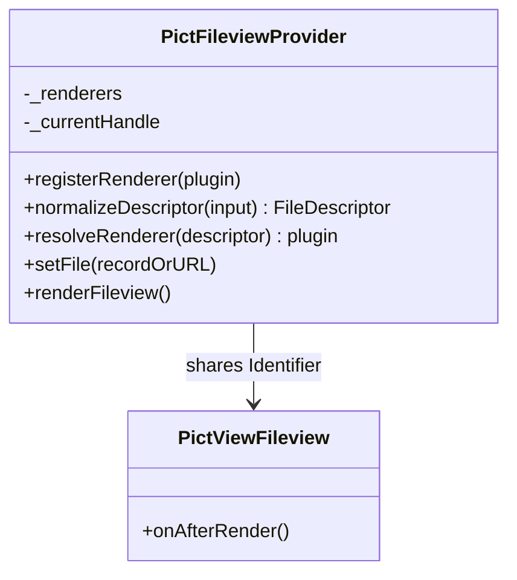
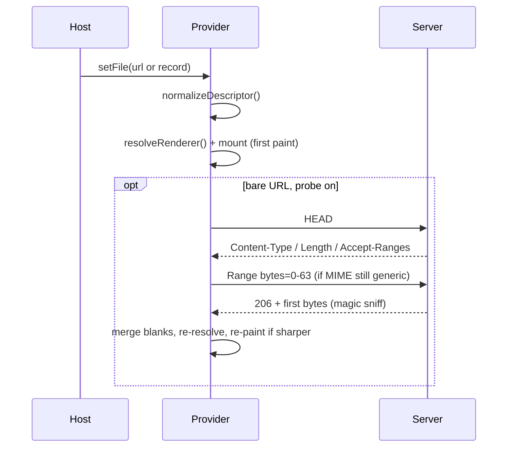

# Architecture

## Overview

`pict-section-fileview` is an **orchestrator, not a renderer.** It owns type detection, a pluggable kind→renderer
registry, the viewer chrome, and child lifecycle — and delegates each media kind to a purpose-built child section
that stays independently usable on any page. New file types are **registry rows**, not changes to the core.

## The provider + view pair

`createFileview(pict, config)` registers two objects under the config's `Identifier`:

- **`PictFileviewProvider`** (extends [`pict-provider`](https://fable-retold.github.io/pict-provider/)) — the
  DOM-free heart: the renderer registry, descriptor normalization, score-tier resolution, the toolbar + stage
  render, the probe ladder, and child lifecycle. All the interesting behavior lives here and is unit-testable
  headless.
- **`PictViewFileview`** (extends [`pict-view`](https://fable-retold.github.io/pict-view/)) — a thin shell that
  paints one container (`toolbar` + `stage`) and, on `onAfterRender`, calls the provider's `renderFileview()`.

They find each other by sharing the `Identifier`, and every element id derives from it, so multiple fileviews
coexist on one page.

## The renderer registry + score-tier resolution

Each renderer is a plain object — `{ Hash, Priority, Capability?(provider), matches(descriptor)→score,
prepareDescriptor?, mount(selector, descriptor, provider)→handle }`. Precedence lives **inside each renderer's
`matches()`** as a score tier, not in a central `if`-ladder:

| Signal | Score |
|---|---|
| explicit config `Kind` | 10000 |
| strong extension | ~700 |
| header `Content-Type` | ~400 |
| magic bytes | ~200 |
| download-card fallback | 1 (always) |

`resolveRenderer()` picks the highest score whose `Capability` gate passes (ties break by `Priority`, then
registration order). A renderer whose dependency is absent **abstains**, so the viewer falls through to the next

```mermaid
flowchart TD
    D[FileDescriptor] --> R{for each renderer}
    R --> C{Capability gate open?}
    C -- no --> R
    C -- yes --> S[score = matches&#40;descriptor&#41;]
    S --> B[keep highest score, then Priority, then order]
    B --> W[winning renderer]
    W --> M[mount into the stage]
```

best — code/markdown degrade to readable text, an image to a plain ``, video/audio to the native
`<video>`/`<audio controls>`, and only a genuinely opaque or non-web-playable file reaches the download card.

## Descriptor normalization + the probe ladder

A host may hand `setFile()` a **Sluice StoredFile record** _or_ a **bare URL string**; both normalize to one
`FileDescriptor`. A record with a `Kind` is authoritative (no probe). A bare URL climbs an async **probe ladder**
— `HEAD` → a `Range` read → a magic-byte sniff — filling only the blanks (MIME, size, range support, magic), then
re-paints if the resolver's answer sharpens.

## Child lifecycle — reuse-one-per-kind

Pict has **no `removeView`**, so re-minting a child per file would leak views, observers, and WebGL contexts. The
provider keeps one handle at a time:

- **Same descriptor** (a bare re-render) → nothing to do.
- **New file, same renderer** → call the handle's `update(descriptor)` to re-feed the live child in place.
- **Type switch** → `destroy()` the old handle, then `mount()` the new one.

```mermaid
flowchart TD
    F[setFile] --> G[resolveRenderer]
    G --> H{same renderer as mounted?}
    H -- yes --> U["update&#40;descriptor&#41; — reuse the live child"]
    H -- no --> X["destroy old -> mount new child section"]
```

## The built-in lenses

```mermaid
flowchart LR
    FV[fileview] --> T[Text &#40;&lt;pre&gt;&#41;]
    FV --> CO[Code -> pict-section-code]
    FV --> MD[Markdown -> pict-section-content]
    FV --> IM[Image -> pict-section-image]
    FV --> VI[Video -> pict-section-video]
    FV --> AU[Audio -> pict-section-audio]
    FV --> PD[PDF -> PDF.js]
    FV --> DZ[Deep Zoom -> OpenSeaDragon + a server DZI pyramid]
    FV --> DC[Download card &#40;the floor&#41;]
```

Every delegating lens is **optional and host-provided** and gates on its dependency; the self-contained lenses
(text, basic image/video/audio, download card) have no external dependency. The deep-zoom lens streams an enormous
image from a server tile pyramid produced by
[`orator-file-service`](https://fable-retold.github.io/orator-file-service/) (libvips `dzsave`) — the client never
holds the whole image.

## Fullscreen

The viewer owns a fill-the-viewport fullscreen (`.pfv-fullscreen`, `position: fixed`) with a document-level
`Escape` handler installed only while maximized — so an embedded child (which runs headless, with its own chrome
suppressed) need not implement its own.
